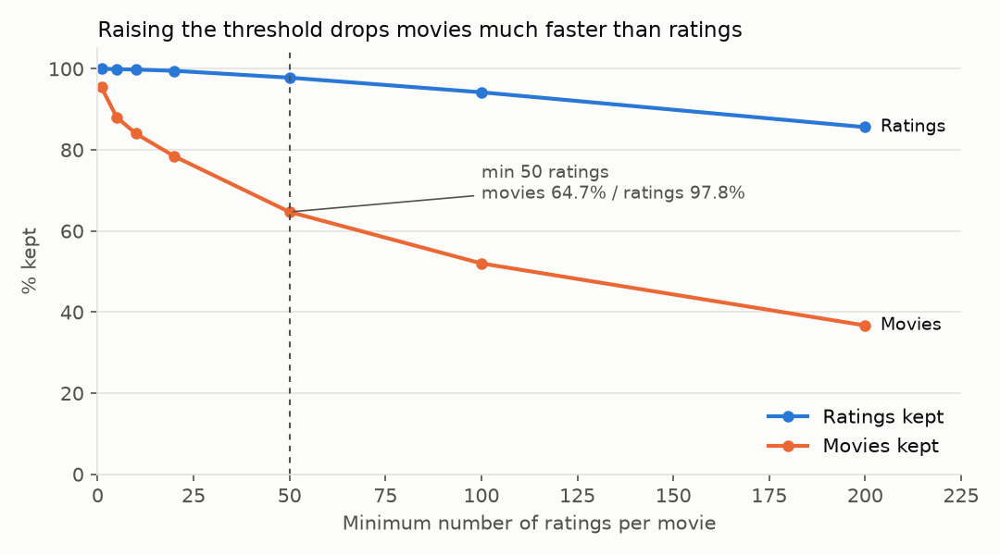
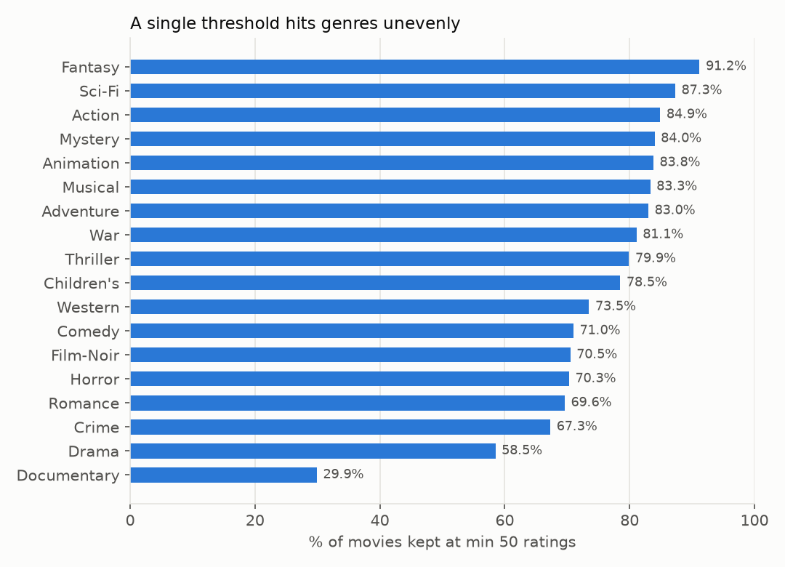

# 영화 카탈로그 평가 데이터 편중 진단 및 추천 후보 선정 기준 설계

> 평가 데이터가 부족한 영화를 추천 후보에서 어떻게 다룰 것인가를 PostgreSQL로 진단하고, 데이터 근거에 기반한 후보 선정 기준을 제안합니다.

## 1. 문제 정의
추천 후보를 고를 때 흔히 "평가 수 N건 이상"으로 거릅니다. 하지만 기준을 높이면 신뢰도는 오르는 대신 카탈로그의 상당 부분이 후보에서 빠집니다.
- 평가는 일부 영화에 얼마나 몰려 있는가?
- 최소 평가 수 기준을 바꾸면 영화와 평점이 각각 얼마나 남는가? 장르별로 다른가?
- 평가가 적은 영화를 버리지 않고 다룰 방법은 없는가?

## 2. 데이터
- MovieLens 1M (GroupLens): 평점 1,000,209건, 영화 3,883편, 사용자 6,040명 (2000-04 ~ 2003-02)
- 원본 데이터는 저장소에 포함하지 않음 (GroupLens 이용 조건)

## 3. 데이터 검증 (`sql/02_validation.sql`)
| 항목 | 결과 |
|---|---|
| (사용자, 영화) 중복 평점 | 0건 |
| movies/users 에 없는 id 를 가진 평점 | 0건 |
| 평점 범위 | 1~5, 결측 0건 |
| 평점이 한 건도 없는 영화 | **177편** |
| 3개 테이블 JOIN 전후 평점 수 | 1,000,209 → 1,000,209 (중복·누락 없음) |

## 4. 분석 결과
**편중** (`04_concentration.sql`)
- 평가 수 상위 10% 영화가 전체 평점의 **45.7%**, 상위 50%가 93.4%를 차지
- 영화당 평가 수 중앙값 109건 vs 평균 258건 → 소수 인기작이 평균을 끌어올림

**최소 평가 수 기준별 유지율** (`05_threshold.sql`)
| 기준 | 남는 영화 | 남는 평점 |
|---|---|---|
| 10건 | 84.0% | 99.8% |
| 50건 | 64.7% | 97.8% |
| 100건 | 52.0% | 94.2% |
| 200건 | 36.7% | 85.6% |



- 50건 기준을 적용하면 평점은 거의 그대로(97.8%)지만 영화는 3분의 1 이상이 후보에서 빠짐
- 장르별 편차가 큼: 50건 기준에서 Documentary는 29.9%, Drama는 58.5%만 남고 Fantasy는 91.2%, Sci-Fi는 87.3%가 남음



**단순 평균의 문제** (`06_proposal.sql`)
- 평균 평점으로 순위를 매기면 상위 10편이 모두 평가 1~3건짜리 5.0점 영화
- 단순 평균 상위 100편 중 **29편**이 평가 50건 미만

## 5. 제안
평가가 적은 영화를 일괄 제외하지 않고, 전체 평균 쪽으로 보정한 **베이지안 평균**으로 비교합니다.

`score = (n × 영화 평균 + m × 전체 평균) / (n + m)`, m = 50

- 보정 후 상위 100편 중 평가 50건 미만 영화: 29편 → **0편**
- 일괄 제외 방식과 달리 평가가 적은 장르(Documentary 등)도 후보군에 남음

## 6. 한계
- 평가 수는 노출량의 영향을 받으므로 "평가가 적다 = 품질이 낮다"는 아님
- m=50 은 기준 비교 결과를 보고 정한 값이며, 실제 서비스에서는 클릭·전환 지표로 검증이 필요
- 2000~2003년 데이터로 현재 이용 패턴과 다를 수 있음

## 7. 재현 방법
```bash
pip install -r requirements.txt
# data/ml-1m/ 에 MovieLens 1M 압축 해제
python scripts/01_convert.py                       # '::' 구분 .dat → UTF-8 CSV
createdb movielens
psql -d movielens -f sql/01_schema.sql
psql -d movielens -c "\copy movies  FROM 'data/csv/movies.csv'  CSV HEADER"
psql -d movielens -c "\copy users   FROM 'data/csv/users.csv'   CSV HEADER"
psql -d movielens -c "\copy ratings FROM 'data/csv/ratings.csv' CSV HEADER"
export PG_DSN="postgresql://postgres@localhost:5432/movielens"
python scripts/02_run_analysis.py                  # 검증·분석 쿼리 13종 실행 → output/*.csv
python scripts/03_make_charts.py                   # output/*.csv → images/*.png
```

## 8. 폴더 구조
```
sql/        01_schema → 02_validation → 03_movie_stats → 04_concentration → 05_threshold → 06_proposal
scripts/    01_convert.py(데이터 변환) · 02_run_analysis.py(쿼리 실행·CSV 저장) · 03_make_charts.py(차트)
output/     쿼리별 결과표 (파일명 = SQL 파일명_쿼리태그.csv)
images/     README 차트
```
